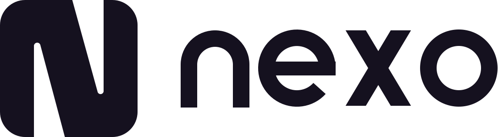
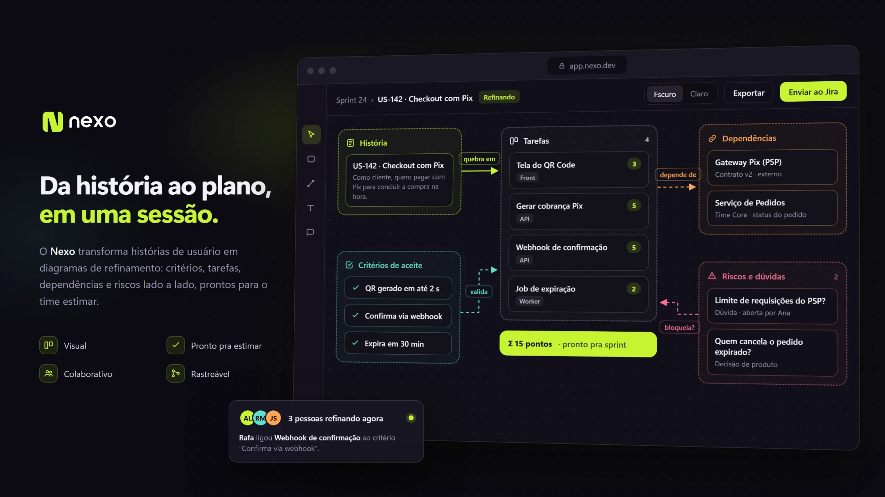

<p align="center">
  <picture>
    <source media="(prefers-color-scheme: dark)" srcset="docs/assets/nexo-lockup-dark.svg" />
    
  </picture>
</p>
<h3 align="center">Da história ao plano, em uma sessão.</h3>

<p align="center"></p>

<p align="center">
  O <strong>Nexo</strong> transforma histórias de usuário, ideias, planos e repositórios em diagramas HTML interativos:
  critérios, tarefas, dependências e riscos lado a lado, prontos para explorar, compartilhar e estimar.
</p>

<p align="center">
  <a href="LICENSE"></a>
  <a href="#instalação"></a>
  
</p>

## O que é

O Nexo é uma *skill* para agentes de IA (Claude Code, Codex, Cursor, OpenCode e GitHub Copilot). Você descreve o que quer entender ou planejar e o agente gera um **arquivo HTML único, interativo e validado**, sem precisar escrever sintaxe de diagrama.

- **10 tipos de diagrama nativos:** arquitetura, workflow, sequência, fluxo de dados, ciclo de vida, ERD, classes, árvore, linha do tempo e cascata (waterfall).
- **Explicações em uma página:** a conclusão primeiro, depois um painel por pergunta, com tabelas, passos, gráficos e diagramas.
- **Diagnóstico de arquitetura:** ciclos de dependência, acoplamento e pontos críticos a partir do código de um repositório.
- **Story e vídeo:** um passo a passo guiado do diagrama, exportável em vídeo 1080p.
- **Fácil de compartilhar:** um único HTML com temas claro e escuro; exporta PNG, WebP, JPG, SVG ou PDF.

## Instalação

**Com um agente de IA**, cole:

```text
Instale o Nexo para mim lendo https://raw.githubusercontent.com/maichado/nexo_dev/main/llms.txt
```

**Ou direto pelo terminal** (troque `claude-code` pelo seu agente: `cursor`, `codex`, `opencode` ou `github-copilot`):

```bash
npx -y skills@latest add maichado/nexo_dev --skill nexo --agent claude-code --global --copy --yes
```

Tire o `--global` para instalar só no projeto atual. Para conferir a instalação:

```bash
node <pasta-da-skill>/bin/nexo.mjs doctor
```

## Primeiros passos

Comece com uma descrição — não precisa de repositório:

```text
Use o Nexo para desenhar: Navegador -> API -> cache Redis -> PostgreSQL quando o cache falhar.
```

Refine uma história de usuário:

```text
Use o Nexo para refinar a US-142 "Checkout com Pix": critérios de aceite, tarefas com
estimativa, dependências externas e riscos abertos, lado a lado.
```

Ou peça uma visão de arquitetura baseada no código:

```text
Analise este repositório e use o Nexo para criar um diagrama de arquitetura de alto nível,
com 8 a 12 componentes, o caminho principal, dependências externas e fronteiras de confiança.
```

Depois, continue a conversa: “adicione autenticação”, “destaque o caminho de rollback”, “mude para o tema claro”.

## Como funciona

| Etapa | O que acontece |
|---|---|
| **Gerar** | O agente cria um JSON tipado a partir da sua descrição. |
| **Validar** | Esquemas e regras de layout verificam a fonte; falhas apontam o reparo exato. |
| **Pré-visualizar** | Opcional: uma sessão local recarrega só versões que passaram na validação. |
| **Entregar** | O HTML só substitui o arquivo de destino se passar em todas as verificações. |
| **Iterar** | O agente ajusta a fonte e mantém estável o que não mudou. |

Comandos úteis no repositório:

```bash
cd nexo
node bin/nexo.mjs doctor
node bin/nexo.mjs demo /tmp/nexo-demo
node bin/nexo.mjs validate workflow examples/agent-tool-call.workflow.json --quality showcase --json
node bin/nexo.mjs deliver workflow examples/agent-tool-call.workflow.json /tmp/workflow.html --quality showcase --open --json
```

## Explorando o resultado

| Ação | Controle |
|---|---|
| Abrir o guia do diagrama | <kbd>?</kbd> |
| Buscar e focar um nó | <kbd>/</kbd> |
| Traçar um caminho entre dois nós | <kbd>R</kbd> ou `PATH` |
| Comparar papéis | <kbd>L</kbd> ou `LENS` |
| Visão geral (radar) | <kbd>M</kbd> ou `MAP` |
| Modo apresentação | <kbd>F</kbd> |
| Estilo / tema / exportar | <kbd>S</kbd> / <kbd>T</kbd> / <kbd>E</kbd> |

O contrato completo de geração e do visualizador está em [`nexo/SKILL.md`](nexo/SKILL.md).

## Desenvolvimento

Requer Node.js 18 ou superior e pnpm.

```bash
pnpm install
pnpm test
```

Veja o [guia de contribuição](CONTRIBUTING.md).

## Licença

[Apache-2.0](LICENSE). O Nexo é um trabalho derivado de software de código aberto; as atribuições exigidas pelas licenças de origem estão em [NOTICE](NOTICE) e [LICENSE-MIT](LICENSE-MIT). Componentes de terceiros mantêm suas próprias licenças.
